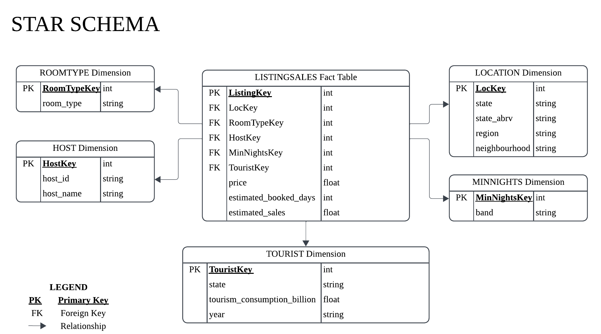
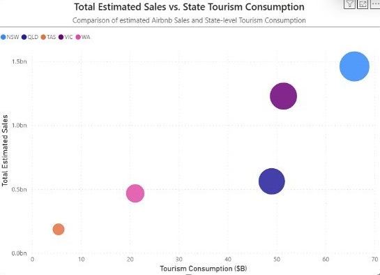
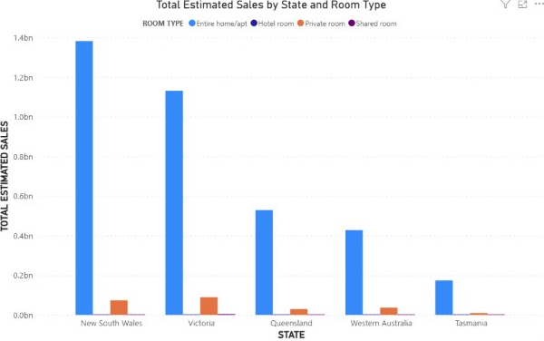

# Airbnb Data Warehouse & BI Analysis

A star-schema data warehouse for Australian Airbnb listings: ETL in Python, a PostgreSQL warehouse, and a Power BI analysis that tests whether state-level tourism spending lines up with estimated Airbnb sales.

Built for ICT394 Business Intelligence Application Development at Murdoch University.

**Tools:** Python (pandas) · JupyterLite · PostgreSQL · Power BI (DAX) · Lucidchart (schema design)

---

## The question

> How does estimated Airbnb sales performance relate to state-level tourism consumption across Australia, and what would that tell a property investor deciding where to enter the short-term rental market?

The listings data only says *where* estimated sales are high. To add the missing context, I extended the schema with an external dimension: state tourism consumption from Tourism Research Australia's State Tourism Satellite Account (2024-25).

## Star schema



| Table | Grain | Rows |
|---|---|---|
| `LISTINGSALES_FactTable` | one row per listing | 81,850 |
| `LOCATION_Dimension` | state / region / neighbourhood | 432 |
| `ROOMTYPE_Dimension` | room type | 4 |
| `HOST_Dimension` | host | 41,264 |
| `MINNIGHTS_Dimension` | minimum-nights band (1, 2-3, 4-7, 8-14, 15-30, 31+) | 6 |
| `TOURISM_Dimension` (external) | state tourism consumption, AUD billions, 2024-25 | 6 |

Two measures are derived in the ETL:

- `estimated_booked_days = 365 - availability_365`
- `estimated_sales = price × estimated_booked_days`

These are **estimates, not actual revenue**. A listing that is unavailable is assumed to be booked.

## ETL (`notebooks/airbnb_etl.ipynb`)

1. Combined 11 regional listing files: 94,945 rows.
2. Checked for blanks and duplicates. 13,095 rows (13.79%) had no price and were **excluded rather than set to zero**, because a zero would silently distort every SUM and AVG downstream. This left 81,850 rows. No exact duplicate rows were found.
3. Listing `id` values repeat across the regional files (30,325 rows share an id with another row). They are different listings, not duplicates, so the fact table uses a surrogate `ListingKey` and keeps the source id as text.
4. Built each dimension with a surrogate key, joined the tourism dimension on state, and exported six CSVs.

## Warehouse (`sql/`)

| File | What it does |
|---|---|
| `01_create_schema.sql` | Creates the tables with primary keys, foreign keys and indexes |
| `02_load_data.sql` | Loads the dimensions, then the fact table |
| `03_validation_and_queries.sql` | Row counts, fact totals, the star join, and the sales-vs-tourism query |

## Power BI findings



**Tourism spending and estimated sales rank the states in the same order.** NSW, VIC, QLD, WA and TAS come out in the same order on both measures. NSW leads at about $1.46bn in total estimated sales, VIC has about $1.23bn, and TAS is lowest at about $0.19bn.

**Queensland is the outlier on size.** Its tourism consumption ($49.0bn) is close to Victoria's ($51.4bn), but its total estimated sales (about $0.56bn) are less than half of Victoria's. Per listing, though, Queensland averages about $52,100 against Victoria's $42,700, so the gap comes from the number of listings rather than weaker listings. The Queensland files cover only Brisbane and the Sunshine Coast (10,774 listings, against 28,734 for Victoria), so state totals partly reflect which regions were supplied. `sql/03_validation_and_queries.sql` (query 4) reproduces these figures.



**Entire homes and apartments dominate everywhere.** They account for roughly 92-95% of estimated sales in each of the five states shown. Private rooms are second, and hotel and shared rooms are negligible.

## Limitations

- Sales are estimated from availability and price, not from real bookings.
- Only 11 regional extracts are included, so state totals are not full-state totals. South Australia has just one region (Barossa Valley, 318 listings) and is not shown in the charts above.
- Five states is too few for a statistical correlation. The finding is about rank order, not strength of relationship.
- Tourism consumption covers all visitor spending, not just accommodation.

## Data

`data/` holds the dimension and fact CSVs produced by the notebook, plus the external tourism dataset. The raw regional listing files are not included. [[ add data source and licence once confirmed ]]

`HOST_Dimension.csv` is also left out because it contains individual host names. Run the notebook against the source listings to regenerate it.

## Repo layout

```
notebooks/   ETL notebook
sql/         schema, load and validation scripts
data/        warehouse CSVs + external tourism dataset
docs/        star schema diagram and Power BI visuals
```

## Author

Patricia Orenza · [Portfolio](https://patriciaorenza.github.io/) · [LinkedIn](https://www.linkedin.com/in/patricia-orenza/)
